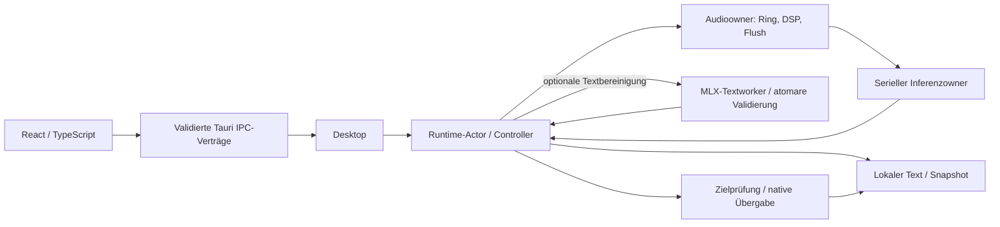

# Code-Wegweiser

## Ein Diktat durch den Code verfolgen

Das ist ein Kontrollfluss, kein Diagramm gemeinsamer veränderbarer Daten.
Ein Fensterstart hält Text lokal; ein Hotkeystart hat zusätzlich ein anfangs
erfasstes Ziel. Ein versandtes Tastaturereignis bestätigt nicht den Zielinhalt.
Ein Cancel entzieht die Berechtigung für weitere Wirkung; es garantiert keinen
sofortigen Abbruch eines bereits laufenden nativen Decoders.

## Modulgrenzen und Lesepfade

| Bereich | Einstieg und Anschluss | Verträge und Risiken |
|---|---|---|
| Reiner Sitzungskern | [session.rs](../crates/dictation-core/src/session.rs) → [controller.rs](../src-tauri/src/controller.rs) | Fakten und Effekte, Starting/Stop/Cancel, Sitzungsnummern, veraltete Ergebnisse und genau einmalige Wirkung |
| Reine Textprüfung | [refinement](../crates/dictation-core/src/refinement/mod.rs) → [Vertragstests](../crates/dictation-core/tests/refinement_contract.rs) | Bedarfsregel, exakt gebundene Änderungsoptionen und atomare Annahme; [zweistufige Prüfung](../crates/dictation-core/src/refinement/staged.rs) prüft Struktur vor Interpunktion, der validierte Typ bleibt an Rohoriginal und Sprache gebunden |
| Bereinigung im Sitzungscontroller | [refinement.rs](../src-tauri/src/controller/refinement.rs), [Controller](../src-tauri/src/controller.rs) | vollständiges Original vor Verarbeitung sichern, späte Ergebnisse ablehnen, Widerruf und einmalige Freigabe über bestehenden Sitzungskern; neue Sitzung entfernt alte Bereinigungsmetadaten, nicht den letzten Text |
| Worker-Protokoll | [Nachrichten](../crates/text-refinement-protocol/src/lib.rs), [Rahmung](../crates/text-refinement-protocol/src/frame.rs) | versionierte 64-KiB-Rahmen, Sitzungs-/Generationsbindung, striktes JSON; Prozessaufsicht und Modellprüfung bleiben Aufgaben des Hosts |
| Lokaler Textworker | [Worker](../crates/text-refinement-worker/README.md), [Prozesssteuerung](../crates/text-refinement-worker/src/lib.rs), [Modell](../crates/text-refinement-worker/src/model.rs), [Scratch-Recovery](../src-tauri/src/refinement_service/scratch.rs) | separater MLX-Owner, begrenzte Ausgabe, private hashgeprüfte Modellkopie und gemeinsam gehaltene Dateisperren; [wortgebundene Interpunktion](../crates/text-refinement-worker/src/punctuation.rs) nach Strukturprüfung, Host prüft beide Stufen erneut; paketierter Worker geprüft, vollständige Produktabnahme noch ausstehend |
| Textworker-Prozessaufsicht | [refinement_service.rs](../src-tauri/src/refinement_service.rs), [asynchroner Owner](../src-tauri/src/refinement_service/owner.rs), [Runtime-Adapter](../src-tauri/src/runtime/refinement.rs), [echte Prozess-Fixtures](../crates/text-refinement-worker/tests/supervisor.rs) | begrenzte Pipes, Identitätsprüfung, ein belegter Auftrag einschließlich unentnommenem Ergebnis, sofortiger Widerruf und kontrolliertes Entladen; Runtime übermittelt und entnimmt asynchron, unterscheidet Dienstfehler von Benutzerabbruch und joint den Owner auch bei weiteren Cleanupfehlern |
| Textmodell-Installation | [refinement.rs](../src-tauri/src/model/refinement.rs), [Setup-Owner](../src-tauri/src/refinement_setup.rs), [Application](../src-tauri/src/application.rs), [Tests](../src-tauri/src/model/refinement/tests.rs) | gemeinsames Worker-Manifest, vollständige Hashprüfung, atomare Satzveröffentlichung, exklusiver Cachebesitz und konservative Stage-Recovery; gesonderter I/O-Owner, lokale Startprüfung und expliziter Download im Einstellungsbereich Textbereinigung |
| Aktivierung nach Texteinstellungen | [Aktivierungsauftrag](../src-tauri/src/desktop/refinement_activation.rs), [Desktop](../src-tauri/src/desktop.rs) | explizite Einrichtung bindet einen widerrufbaren Auftrag; aktuelle Setup-Prüfung statt verzögertem UI-Snapshot, einmalige Übergabe an die bestehende Präferenztransaktion und sichtbare Fehler |
| Steuerung und Lebensdauer | [control.rs](../src-tauri/src/control.rs), [runtime.rs](../src-tauri/src/runtime.rs), [main.rs](../src-tauri/src/main.rs) | begrenzte Anfragen, gesonderte Stop/Cancel/Shutdown-Signale, Admission schließen, Besitzer joinen, Panic- und Powerpfade |
| Mikrofon und DSP | [audio.rs](../src-tauri/src/audio.rs) → [Core-DSP](../crates/dictation-core/src/audio.rs), [Aufnahmegrenzen](../crates/dictation-core/src/recording_limits.rs) | Callback produziert in den Ring; gemeinsamer CPAL-Fehlercallback meldet Streamfehler; Audioowner verarbeitet, schließt, drainiert und flusht; Sample-/Kanal-/Raten- und Speichergrenzen |
| Inferenz | [inference_service.rs](../src-tauri/src/inference_service.rs) → [transcription.rs](../src-tauri/src/transcription.rs), [speech_gate.rs](../src-tauri/src/transcription/speech_gate.rs) | serielle Arbeit, warme Gewichte/frischer ASR-State, Job-/Session-/Generation-/Bereichsbindung, getrennte VAD-Kopie, Fehler statt scheinbarer Stille |
| Modellbereitstellung | [setup.rs](../src-tauri/src/setup.rs), [model.rs](../src-tauri/src/model.rs) und [Cache](../src-tauri/src/model/cache.rs)/[Speicher](../src-tauri/src/model/storage.rs) | Größen-/Hashprüfung, Transportfehler, Cancel, Cachebesitz, eigene Teildateien und erfolgreicher Übergang zur geladenen Runtime |
| Ziel und Versand | [native_service.rs](../src-tauri/src/native_service.rs) → [Targetworker](../crates/macos-integration/src/target/worker.rs), [target.rs](../crates/macos-integration/src/target.rs), [main_delivery.rs](../crates/macos-integration/src/main_delivery.rs) | Main Thread gegenüber AX-Owner, Prozess-/Feldidentität, Rechte/Secure Input, Commitpunkt und Zurückhalten statt unsicherem Versand |
| Clipboard und Ereignis | [clipboard.rs](../crates/macos-integration/src/clipboard.rs), [delivery.rs](../crates/macos-integration/src/delivery.rs), [paste.rs](../crates/macos-integration/src/paste.rs) | begrenzter Snapshot/Helper, Eigentumswechsel, Restore, Cancel gegen Commit, Ereignisversand gegenüber tatsächlichem Empfang |
| Hotkey und System | [hotkeys.rs](../src-tauri/src/hotkeys.rs), [keyboard.rs](../crates/macos-integration/src/keyboard.rs), [glass_header.rs](../crates/macos-integration/src/glass_header.rs), [power.rs](../crates/macos-integration/src/power.rs), [Speicherdruck](../crates/macos-integration/src/memory_pressure.rs) | Öffentliche Drucksignale halten Textbereinigung zurück; Registrierungsbesitz und Fehler, physische Taste/Layout, Main-Thread-/View-Lebensdauer (Glasadapter bleibt isoliert, nicht mehr angehängt), Observer entfernen, FFI-Sicherheitsargumente |
| Aktive Layoutbeschriftung | [Layouttabelle](../crates/macos-integration/src/keyboard/labels.rs), [TIS-Observer](../crates/macos-integration/src/keyboard/observer.rs), [Hostprojektion](../src-tauri/src/hotkey_labels.rs) | aktuelles Layout gegenüber physischer Registrierung, Plain-/Command-Ebene, atomare Tabelle, Fallback, Hauptthread und explizites Entfernen |
| Menüleisten-Rückmeldung | [Feedbackprojektion](../src-tauri/src/feedback.rs), [Desktop](../src-tauri/src/desktop.rs), [nativer Ton](../crates/macos-integration/src/feedback.rs) | begrenzte zuletzt zurückgehaltene Sitzungs-ID statt Textdeduplizierung, Status vor Ton, Aufnahmezulassung während Tonanforderung sperren, kein Fenster/Fokus; Aufruf ist keine Hör- oder Playback-Endquittung |
| Entwickler-Messwerkzeug | [Replay-Runner](../src-tauri/examples/paced_runtime_probe/runner.rs), [Parameterbindung](../src-tauri/examples/paced_runtime_probe/parameters.rs), [TC-Publisher](../crates/macos-integration/src/realtime.rs), [historischer QoS-Pfad](../crates/macos-integration/src/qos.rs), [serieller Prozessowner](../scripts/controlled-probe.ts) | feste Zeitgrenzen und identische Samples, Policy nur im eigenen neuen Thread, Admission vor Aufnahme, diskrete Policy-/CPU-Beobachtungen, Publisher- und Runtimejoin; keine kontinuierliche Echtzeitgarantie |
| Einstellungen und IPC | [settings.rs](../src-tauri/src/settings.rs), [preferences.rs](../src-tauri/src/preferences.rs), [startup_settings.rs](../src-tauri/src/startup_settings.rs), [ipc.rs](../src-tauri/src/ipc.rs) | validierte Eingaben, atomare private Speicherung/Rücknahme, Recovery, sitzungsgebundene Kommandos und gesperrte Änderungen während Arbeit |
| Aktive React-/TypeScript-Oberfläche | [main.tsx](../src/main.tsx), [App.tsx](../src/App.tsx), [IPC-Client](../src/ipc/index.ts), [AppView](../src/features/app/AppView.tsx), [SettingsView](../src/features/settings/SettingsView.tsx) | Zustandsabonnement, validierte IPC-Daten, Fehler, Einstellungen und Recovery; Rust bleibt Besitzer von Audio, Inferenz und Systemeffekten |
| Autonome technische Tests und eigener Beobachter | [Runner](../scripts/autonomous-tests.mjs), [öffentlicher Fixture-Connector](../src-tauri/src/runtime/tests/autonomous_contract.rs), [eigenes Testfenster](../crates/macos-integration/examples/native_text_recipient.rs) | Tatsächliche Runtime-/PCM-Verträge gegenüber kontrolliertem Decoder/Native-Endpunkt; frischer eigener Fensterbericht gegenüber realer Everlast-Zielerfassung; kein automatischer ASR-/UI-Lauf |
| Lokale Bereitstellungswerkzeuge | [MLX-Paketbau](../scripts/build-mlx-bundle.mjs), [Bundleprüfung](../scripts/verify-bundle.mjs), [Signierhelper](../scripts/sign-local-bundle.mjs), [Kontinuitätsvergleich](../scripts/verify-signing-continuity.mjs) | App und Textworker mit identischen Metal-Kernels, feste ausführbare Dateien, verschachtelte Signierreihenfolge, Architektur/Systembibliotheken und Entitlements; gleiche Requirement ist noch kein nachgewiesener Rechteerhalt |
| Übernommenes SDK | [whisper-rs-Patches](../vendor/whisper-rs/PATCHES.md), [sys-/C++-Patches](../vendor/whisper-rs-sys/PATCHES.md), [Hotkey-Patch](../vendor/global-hotkey/PATCHES.md) | echte Herkunft/Lizenzen, unveränderte gegenüber eigenen Teilen, C-/Rust-Grenze, Pointerlebensdauer und Grenze der lokalen Regressionen |

Native und React-Copy-Aktionen besitzen den tatsächlich angezeigten Text.
React überträgt ihn explizit über `copyTranscript` an `transcript_copy`; Rust
validiert die UTF-8-Größe vor dem nativen Clipboard-Aufruf. Copy benötigt keinen
laufenden Inferenzdienst. Conditional Clear vergleicht unmittelbar am seriellen
Runtime-Dequeue und hält inzwischen anderen Text zurück.

Einstellungsdateien der Version 1 werden typisiert auf Version 2 migriert; die
zusätzliche Bereinigungspräferenz bleibt dabei ausgeschaltet. Start, Speicherung
und Rollback verwenden denselben Decoder. Der Application-Owner richtet einen
trägen Textworker am festgelegten Bundle-Pfad ein. Fehler der optionalen
Textlaufzeit bleiben sichtbar und verhindern den ASR-Start nicht. Aktivierung
verlangt eine fertige Modelleinrichtung; die Präferenz wird pro Sitzung eingefroren.
Angenommene Downloads sperren neue Aufnahmen bereits vor ihrem I/O-Start.

`running=false` hat in React Vorrang vor Setup, Sitzung und Einstellungen:
Neustarthilfe und letzter Text bleiben verfügbar, dienstabhängige Aktionen nicht.
`desktop/action_errors.rs` bindet transiente Meldungen an die aktuelle Anfrage;
späte Quittungen ändern keinen neueren Fehler. Dauerhafte Hotkeyfehler werden
separat geführt. Beim Dienstabschluss bleiben Initiierungs- und Cleanupursachen
sichtbar. `audio/input_config.rs` wählt nur vom Gerät angebotene und vom DSP
bereits unterstützte Formate vor dem Streamstart.

Die [Offline-Verträge](verification/offline-contracts-2026-10-19.md) bleiben
historische Belege ihrer dort gebundenen Capture-/Settings-Verträge.

## Tests und tatsächliche Beobachtungen zuordnen

- Der Kern hat [Sitzungsinvarianten](../crates/dictation-core/tests/session_invariants.rs),
  [unabhängige Audiosignale](../crates/dictation-core/tests/audio_properties.rs)
  und [Grenztests](../crates/dictation-core/tests/recording_limits.rs).
- Runtime-/Adapter-/Inferenztests stehen zusätzlich direkt in den jeweiligen
  Rust-Modulen; [Maximum](../src-tauri/src/runtime/tests/maximum_contract.rs)
  und [Neustart](../src-tauri/src/runtime/tests/restart_contract.rs) prüfen deren
  Verkabelung. Kontrollierte Worker sind keine nativen Mikrofone oder Empfänger.
- React-/IPC-Tests stehen bei den Komponenten und beim Client. `src/main.tsx`
  mountet die aktive React-Oberfläche. DOM-Tests prüfen die Ansichten und
  IPC-Reaktionen, aber keine native VoiceOver-, Fokus- oder Fensterdarstellung.
- Der [selbst ausgeführte Funktionstest](verification/self-run-functional-2026-10-19.md)
  belegt echte Aufnahme und manuelles Kopieren/Einfügen in ein eigenes Testziel,
  keine automatische Zielerfassung oder automatische Übergabe. Der
  [native Lifecycle-Test](verification/native-lifecycle-2026-10-19.md) belegt
  Beenden während Aufnahme und 100 Start-/Cancel-Zyklen. Der spätere
  [technische Kurztest](verification/release-fixes-2026-10-21.md) ergänzt echten Empfang
  in Notes; der [Palette-Test](verification/palette-2026-10-21.md) die aktuelle UI.
  Eine vollständige Sleep/Wake- oder Bluetooth-Wechselmatrix wird nicht behauptet.
- [Qualität](verification/acceptance-reference-v1.md),
  [Inferenz-Lifecycle](verification/inference-lifecycle.md),
  [Runtime-Ressourcen](verification/runtime-resource.md) und
  [Echtzeitprotokoll](verification/paced-reference-protocol.md) enthalten die
  jeweiligen Laufbelege und Grenzen. Die private Audiodatei wird nicht als
  unabhängige Goldreferenz ausgegeben.

## Palette und progressive Offenlegung

`AppView` zeigt Status, echte RMS-Pegelvisualisierung und Aufnahmeaktionen. Neue
abgeschlossene Sitzungs-IDs öffnen den letzten Text; gleiche Textinhalte gelten
nicht als gleiche Sitzung. Die Offenlegung von Text/Aufnahmedetails verändert nur
das Layout. `App` fordert über `src/ipc/window.ts` kompakte, erweiterte oder
Einstellungsgröße an; dabei bleibt die logische Nutzerbreite erhalten. Überholte
Größenabfragen werden verworfen, Größenfehler bleiben sichtbar. Tauri erlaubt nur
dem lokalen Hauptfenster die erforderlichen Größenabfragen/-änderung.
`DESIGN.md` beschreibt die bestätigte Oberfläche einschließlich Systemthemes.

Der Bereich Textbereinigung bietet Einrichtung, Abbruch und den gespeicherten
Schalter an. Nach Sitzungsende ist die aktive ID leer; die Ergebnisansicht nutzt
dann die erhaltene Bereinigungskennung. Während einer neuen Aufnahme gilt wieder
die exakte aktive ID. Fehler und Abbruch zeigen das Original mit Kopieraktion,
bearbeitete Ergebnisse bieten zusätzlich das ursprüngliche Transkript hinter
einer Offenlegung. Die [UI-Verifikation](verification/refinement-ui-2026-10-22.md)
grenzt Browserdarstellung und Vertragstests von der noch ausstehenden Paketabnahme ab.

Aktive Entwicklerwerkzeuge und der Umgang mit historischen Messreihen stehen in
[tooling.md](tooling.md).

Die [kontextgebundene Korrekturprüfung](verification/refinement-context-2026-10-22.md)
verbindet den erweiterten Fallkorpus mit den nativen Start-/Abbruchbeobachtungen.
Der Host erzeugt Worker-Verzeichnisse direkt mit privaten `0700`-Rechten; ein
bestehender ASR-/Rohworker-Nachweis ersetzt diese Hostgrenze nicht.
