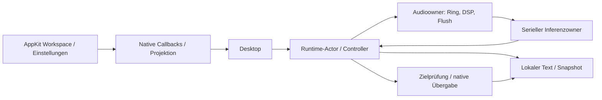

## Ein Diktat durch den Code verfolgen

Das ist ein Kontrollfluss, kein Diagramm gemeinsamer veränderbarer Daten.
Ein Fensterstart hält Text lokal; ein Hotkeystart hat zusätzlich ein anfangs
erfasstes Ziel. Ein versandtes Tastaturereignis bestätigt nicht den Zielinhalt.
Ein Cancel entzieht die Berechtigung für weitere Wirkung; es garantiert keinen
sofortigen Abbruch eines bereits laufenden nativen Decoders.

## Modulgrenzen und Lesepfade

| Bereich | Einstieg und Anschluss | Bei der eigenen Erklärung besonders prüfen |
|---|---|---|
| Reiner Sitzungskern | [session.rs](../crates/dictation-core/src/session.rs) → [controller.rs](../src-tauri/src/controller.rs) | Fakten und Effekte, Starting/Stop/Cancel, Sitzungsnummern, veraltete Ergebnisse und genau einmalige Wirkung |
| Steuerung und Lebensdauer | [control.rs](../src-tauri/src/control.rs), [runtime.rs](../src-tauri/src/runtime.rs), [main.rs](../src-tauri/src/main.rs) | begrenzte Anfragen, gesonderte Stop/Cancel/Shutdown-Signale, Admission schließen, Besitzer joinen, Panic- und Powerpfade |
| Mikrofon und DSP | [audio.rs](../src-tauri/src/audio.rs) → [Core-DSP](../crates/dictation-core/src/audio.rs), [Aufnahmegrenzen](../crates/dictation-core/src/recording_limits.rs) | Callback produziert in den Ring; gemeinsamer CPAL-Fehlercallback meldet Streamfehler; Audioowner verarbeitet, schließt, drainiert und flusht; Sample-/Kanal-/Raten- und Speichergrenzen |
| Inferenz | [inference_service.rs](../src-tauri/src/inference_service.rs) → [transcription.rs](../src-tauri/src/transcription.rs), [speech_gate.rs](../src-tauri/src/transcription/speech_gate.rs) | serielle Arbeit, warme Gewichte/frischer ASR-State, Job-/Session-/Generation-/Bereichsbindung, getrennte VAD-Kopie, Fehler statt scheinbarer Stille |
| Modellbereitstellung | [setup.rs](../src-tauri/src/setup.rs), [model.rs](../src-tauri/src/model.rs) und [Cache](../src-tauri/src/model/cache.rs)/[Speicher](../src-tauri/src/model/storage.rs) | Größen-/Hashprüfung, Transportfehler, Cancel, Cachebesitz, eigene Teildateien und erfolgreicher Übergang zur geladenen Runtime |
| Ziel und Versand | [native_service.rs](../src-tauri/src/native_service.rs) → [Targetworker](../crates/macos-integration/src/target/worker.rs), [target.rs](../crates/macos-integration/src/target.rs), [main_delivery.rs](../crates/macos-integration/src/main_delivery.rs) | Main Thread gegenüber AX-Owner, Prozess-/Feldidentität, Rechte/Secure Input, Commitpunkt und Zurückhalten statt unsicherem Versand |
| Clipboard und Ereignis | [clipboard.rs](../crates/macos-integration/src/clipboard.rs), [delivery.rs](../crates/macos-integration/src/delivery.rs), [paste.rs](../crates/macos-integration/src/paste.rs) | begrenzter Snapshot/Helper, Eigentumswechsel, Restore, Cancel gegen Commit, Ereignisversand gegenüber tatsächlichem Empfang |
| Hotkey, Glas und System | [hotkeys.rs](../src-tauri/src/hotkeys.rs), [keyboard.rs](../crates/macos-integration/src/keyboard.rs), [glass.rs](../crates/macos-integration/src/glass.rs), [power.rs](../crates/macos-integration/src/power.rs) | Registrierungsbesitz und Fehler, physische Taste/Layout, Main-Thread-/View-Lebensdauer, Observer entfernen, FFI-Sicherheitsargumente |
| Aktive Layoutbeschriftung | [Layouttabelle](../crates/macos-integration/src/keyboard/labels.rs), [TIS-Observer](../crates/macos-integration/src/keyboard/observer.rs), [Hostprojektion](../src-tauri/src/hotkey_labels.rs) | aktuelles Layout gegenüber physischer Registrierung, Plain-/Command-Ebene, atomare Tabelle, Fallback, Hauptthread und explizites Entfernen |
| Menüleisten-Rückmeldung | [Feedbackprojektion](../src-tauri/src/feedback.rs), [Desktop](../src-tauri/src/desktop.rs), [nativer Ton](../crates/macos-integration/src/feedback.rs) | begrenzte zuletzt zurückgehaltene Sitzungs-ID statt Textdeduplizierung, Status vor Ton, Aufnahmezulassung während Tonanforderung sperren, kein Fenster/Fokus; Aufruf ist keine Hör- oder Playback-Endquittung |
| Entwickler-Messwerkzeug | [Replay-Runner](../src-tauri/examples/paced_runtime_probe/runner.rs), [Parameterbindung](../src-tauri/examples/paced_runtime_probe/parameters.rs), [TC-Publisher](../crates/macos-integration/src/realtime.rs), [historischer QoS-Pfad](../crates/macos-integration/src/qos.rs), [serieller Executor](../scripts/run-paced-remainder.py) | feste Zeitgrenzen und identische Samples, Policy nur im eigenen neuen Thread, Admission vor Aufnahme, diskrete Policy-/CPU-Beobachtungen, Publisher- und Runtimejoin; keine kontinuierliche Echtzeitgarantie |
| Einstellungen und IPC | [settings.rs](../src-tauri/src/settings.rs), [preferences.rs](../src-tauri/src/preferences.rs), [startup_settings.rs](../src-tauri/src/startup_settings.rs), [ipc.rs](../src-tauri/src/ipc.rs) | validierte Eingaben, atomare private Speicherung/Rücknahme, Recovery, sitzungsgebundene Kommandos und gesperrte Änderungen während Arbeit |
| Native Oberfläche und Zustandsprojektion | [Workspace](../crates/macos-integration/src/native_workspace.rs), [Preferences](../crates/macos-integration/src/native_preferences.rs), [Callback-Bridge](../src-tauri/src/desktop/native_ui.rs), [Projektion](../src-tauri/src/native_presentation.rs), [Desktop](../src-tauri/src/desktop.rs) und [Start](../src-tauri/src/main.rs) | Main-Thread-Besitz, Snapshotrevisionen statt eigener Sitzungsmaschine, Listener/Wakeup ohne Renderer, Abmeldung, Fensterlebensdauer und geordnetes Beenden; native Aktionen verwenden bestehende Admission und Runtime |
| Historische React-/IPC-Oberfläche | [App.tsx](../src/App.tsx), [IPC-Client](../src/ipc/index.ts), [AppView](../src/features/app/AppView.tsx), [SettingsView](../src/features/settings/SettingsView.tsx), [RecoveryView](../src/features/settings/RecoveryView.tsx), [Vertrag](../src-tauri/src/contracts.rs) | Kompatibilitätscode; die aktuelle sichtbare Oberfläche läuft nicht über diese React-Komponenten. DOM-Tests sind kein Nachweis für AppKit |
| Autonome technische Tests und eigener Beobachter | [Runner](../scripts/autonomous-tests.mjs), [öffentlicher Fixture-Connector](../src-tauri/src/runtime/tests/autonomous_contract.rs), [eigenes Testfenster](../crates/macos-integration/examples/native_text_recipient.rs) | Tatsächliche Runtime-/PCM-Verträge gegenüber kontrolliertem Decoder/Native-Endpunkt; frischer eigener Fensterbericht gegenüber realer Everlast-Zielerfassung; kein automatischer ASR-/UI-Lauf |
| Lokale Bereitstellungswerkzeuge | [Signierhelper](../scripts/sign-local-bundle.mjs), [Kontinuitätsvergleich](../scripts/verify-signing-continuity.mjs) | Explizite Build-/Signierwirkung, erwartete Bundle-Struktur/Entitlements, echte Signaturprüfung; gleiche Requirement ist noch kein nachgewiesener Rechteerhalt |
| Übernommenes SDK | [whisper-rs-Patches](../vendor/whisper-rs/PATCHES.md), [sys-/C++-Patches](../vendor/whisper-rs-sys/PATCHES.md), [Hotkey-Patch](../vendor/global-hotkey/PATCHES.md) | echte Herkunft/Lizenzen, unveränderte gegenüber eigenen Teilen, C-/Rust-Grenze, Pointerlebensdauer und Grenze der lokalen Regressionen |

Native Copy-/Clear-Aktionen besitzen den tatsächlich angezeigten Text. Copy
verwendet dieses Payload; Conditional Clear vergleicht unmittelbar am seriellen
Runtime-Dequeue und hält inzwischen anderen Text zurück. Der ältere unbedingte
Clear-Pfad bleibt für seine bisherigen Aufrufer bestehen. Die
[Offline-Verträge](verification/offline-contracts-2026-10-19.md) dokumentieren
Assertion-REDs, Fix und Grenzen der neuen Capture-/Settings-Verbundtests.

## Tests und tatsächliche Beobachtungen zuordnen

- Der Kern hat [Sitzungsinvarianten](../crates/dictation-core/tests/session_invariants.rs),
  [unabhängige Audiosignale](../crates/dictation-core/tests/audio_properties.rs)
  und [Grenztests](../crates/dictation-core/tests/recording_limits.rs).
- Runtime-/Adapter-/Inferenztests stehen zusätzlich direkt in den jeweiligen
  Rust-Modulen; [Maximum](../src-tauri/src/runtime/tests/maximum_contract.rs)
  und [Neustart](../src-tauri/src/runtime/tests/restart_contract.rs) prüfen deren
  Verkabelung. Kontrollierte Worker sind keine nativen Mikrofone oder Empfänger.
- React-/IPC-Tests stehen bei den Komponenten und beim Client. `src/main.tsx`
  lädt nur den Starttext und CSS; die sichtbaren Controls sind AppKit. DOM-Tests
  beweisen keine native VoiceOver-, Fokus- oder Fensterdarstellung.
- Der [selbst ausgeführte Funktionstest](verification/self-run-functional-2026-10-19.md)
  belegt echte Aufnahme und manuelles Kopieren/Einfügen in ein eigenes Testziel,
  keine automatische Zielerfassung oder automatische Übergabe. Der
  [native Lifecycle-Test](verification/native-lifecycle-2026-10-19.md) belegt
  Beenden während Aufnahme und 100 Start-/Cancel-Zyklen. Sleep/Wake,
  Bluetooth-Wechsel und Notes bleiben eigenständige offene Abnahmen.
- [Qualität](verification/acceptance-reference-v1.md),
  [Inferenz-Lifecycle](verification/inference-lifecycle.md),
  [Runtime-Ressourcen](verification/runtime-resource.md) und
  [Echtzeitprotokoll](verification/paced-reference-protocol.md) enthalten die
  jeweiligen Laufbelege und Grenzen. Die private Audiodatei wird nicht als
  unabhängige Goldreferenz ausgegeben.

Der [aktuelle Quellenaudit](verification/personal-review-v3-05413c2-delta.json)
trennt die test-only Runtime-Modulregistrierung von den neuen ausführbaren
Entwickler-/Signierwerkzeugen. Alle 107 ursprünglichen Anker bleiben gegenüber
`2abf495` auf gleicher Zeile; E1/E2/O1/O2 bleiben erhalten. Die installierte
lokal signierte B-App 0.1.1 stammt aus `40e7eaf`, nicht aus den späteren
Helper-Commits. [A/B-Signaturvergleich](verification/local-signing-2026-10-19.md)
und [eigener Beobachter](verification/native-recipient-observer-2026-10-19.md)
sind technische Teilbelege; erste OS-Freigabe und realer A/B-Rechteerhalt bleiben offen.

Für den aktuellen Inferenzpfad zusätzlich `Engine::transcribe` bis
`decode::<false, _>` verfolgen: Der produktive Decoder erlaubt interne
Timestamp-Tokens; die historischen Beobachtungsläufe mit unterdrückten
Timestamp-Tokens bleiben getrennte Vergleichsbelege. Das ist keine nachträgliche
Textdeduplizierung. Im Messpfad besitzt `MeasuredStopHandle` nur Client,
Sitzungs-ID und Trace, keinen Runtimeowner. Sein Zeitstempel entsteht vor den
Locks; ein noch gehaltener Stophandle darf das Runtimejoin nicht verhindern.
Die [zentrale TC-Messung](verification/paced-six-reference-v4.md) dokumentiert
auch die verfehlte absolute Latenzgrenze. Ein gültiger Einspeisetakt ersetzt
weder Textqualität noch reale Mikrofon-, Hotkey- oder Empfängerabnahmen.

## Ergänzung 19.10.2026: installierter Prüfstand nach Rechtevergleich
